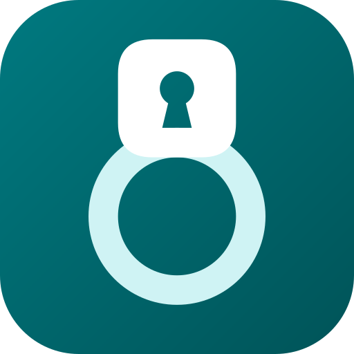
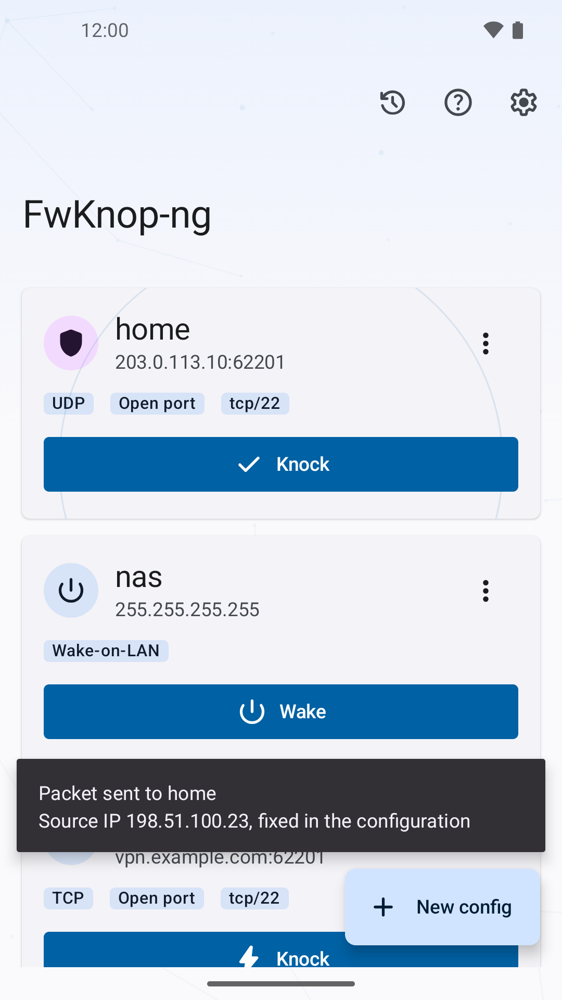
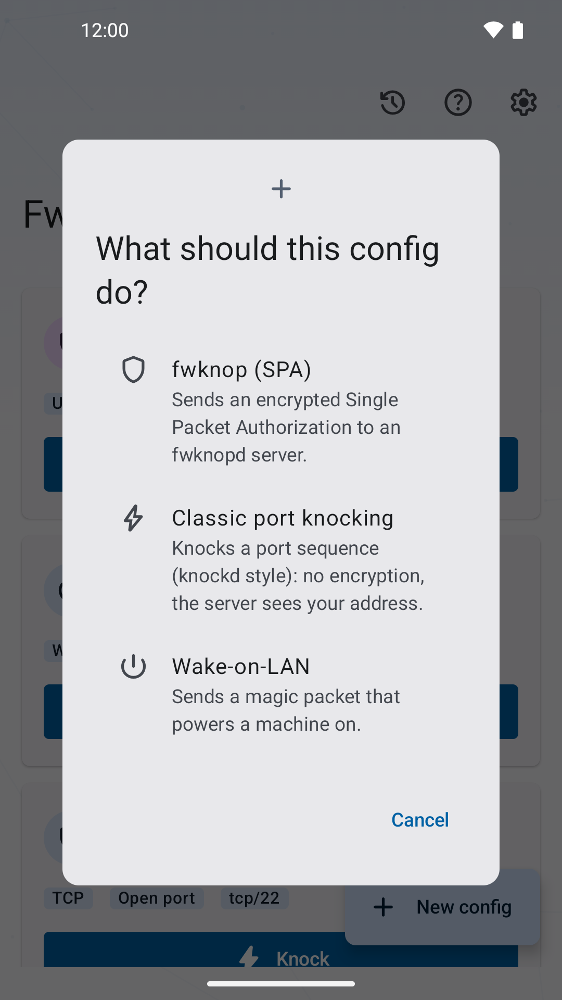
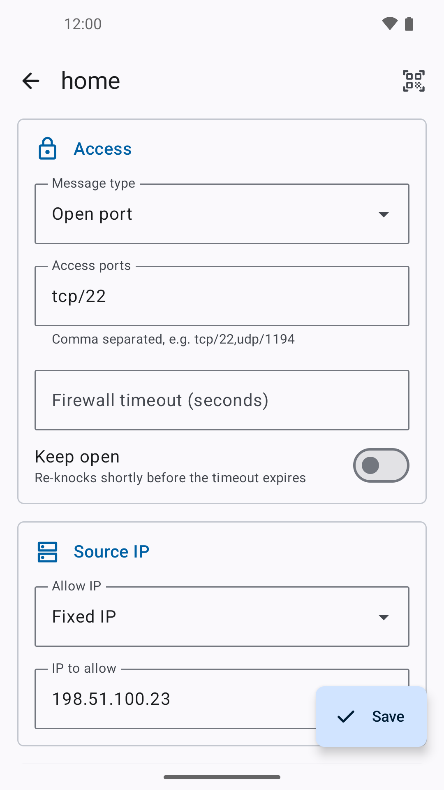
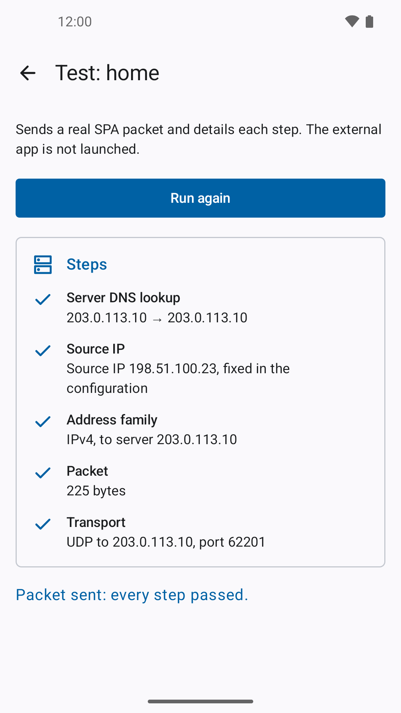
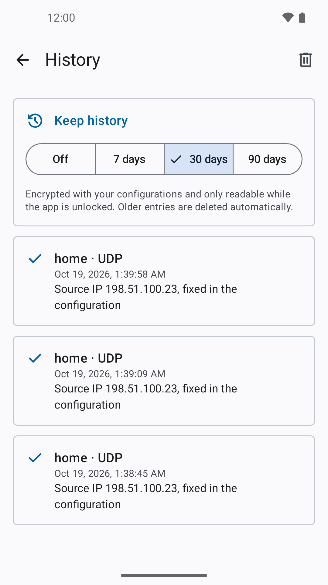
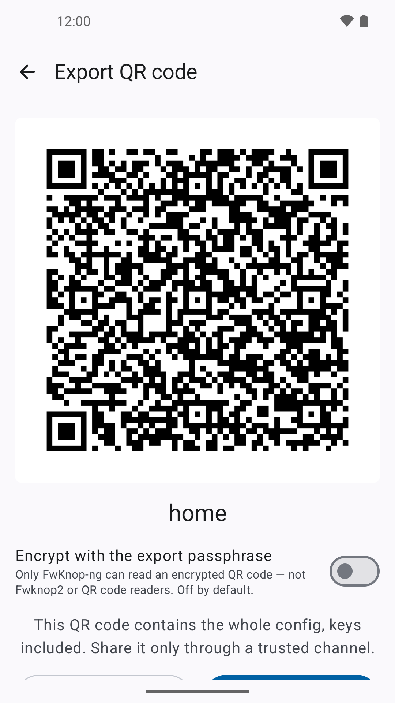
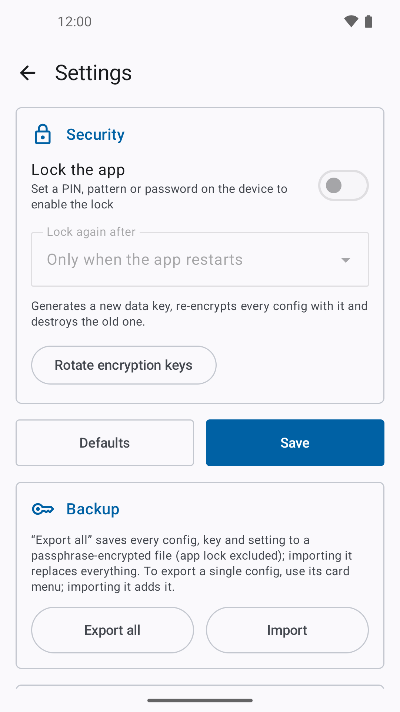
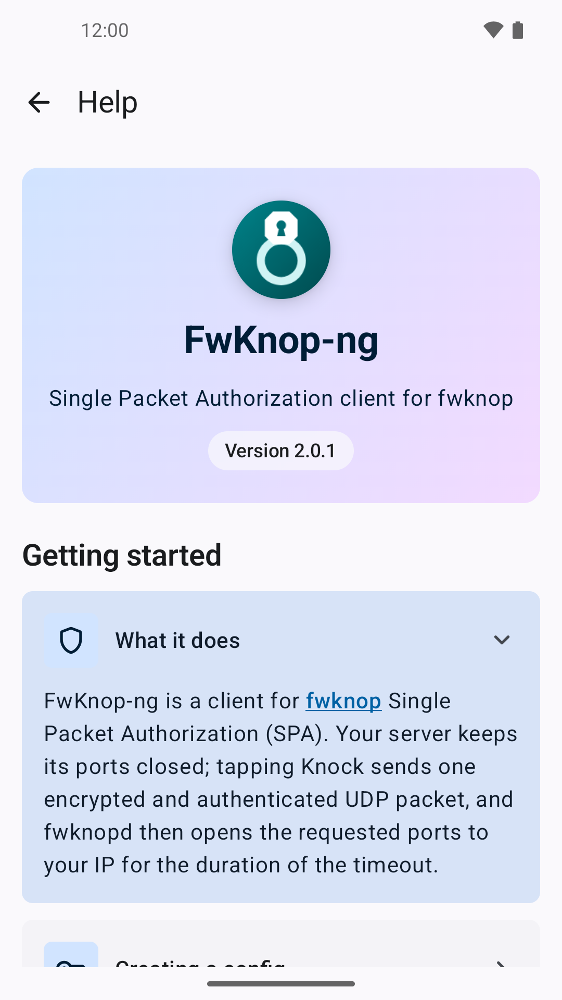

# FwKnop-ng



An Android client for [fwknop](https://www.cipherdyne.org/fwknop/) (Single Packet Authorization).

FwKnop-ng sends an encrypted, authenticated SPA packet that makes a `fwknopd` server open a firewall port for your IP address — keeping services such as SSH or VPN invisible to everyone else.

[](COPYING)


## Features

- **SPA encryption**: Rijndael (AES) or GPG (via [OpenKeychain](https://www.openkeychain.org/)), with HMAC authentication (MD5, SHA-1, SHA-256, SHA-384, SHA-512)
- **Transports**: UDP, TCP and HTTP
- **Access modes**: access, NAT access, local NAT and client-defined timeouts
- **Source IP resolution**: STUN or a configurable HTTPS lookup URL
- **Keep-open**: re-sends SPA packets before the firewall rule expires or after a network change
- **Automatic knock** (off by default): knocks when leaving a trusted Wi-Fi network
- **Diagnostics**: configuration test, optional TCP check of the opened ports, local knock history
- **Post-knock actions**: launch an SSH client, an OpenVPN profile or a WireGuard tunnel
- **Encrypted storage**: configurations protected by Android Keystore, Tink and SQLCipher
- **App lock**: biometrics or device credential
- **Backup & sharing**: encrypted backup/restore, QR code import/export
- **NFC**: trigger a knock by tapping an NFC tag
- **Languages**: English, French

## Screenshots

| Knock | Config types | Edit | Test |
|:-:|:-:|:-:|:-:|
|  |  |  |  |
| **History** | **QR export** | **Settings** | **Help** |
|  |  |  |  |

## Installation

- **F-Droid**: build metadata is available in [`metadata/`](metadata/fr.gildasledrogoff.fwknop.yml)
- **GitHub**: download the APK from the [releases page](https://github.com/gildas-le-drogoff/FwKnop-ng/releases)
- **From source**: see below

Requires Android 8.0 (API 26) or later.

> [!WARNING]
> Configurations are bound to the device's Android Keystore. Removing the screen lock or performing a factory reset makes them unrecoverable. Keep your fwknop keys elsewhere, or use the encrypted backup.

## Building

Requirements: JDK 21 and the Android SDK (compile SDK 37).

```sh
git clone https://github.com/gildas-le-drogoff/FwKnop-ng.git
cd FwKnop-ng
./gradlew assembleDebug
```

The APK is generated in `app/build/outputs/apk/`.

### Release signing

Release builds are signed only if a `keystore.properties` file exists at the project root; otherwise an unsigned release APK is produced.

```properties
storeFile=path/to/keystore.jks
storePassword=...
keyAlias=...
keyPassword=...
```

```sh
./gradlew assembleRelease
```

### Tests

```sh
./gradlew test                 # unit tests
./gradlew connectedAndroidTest # instrumented tests
```

To generate a baseline profile (API 33+ device or emulator): `./gradlew :app:generateBaselineProfile`.

Dependencies are locked; after changing a dependency, refresh the lockfiles with:

```sh
./gradlew dependencies --write-locks
```

## Architecture

The app module follows a clean-architecture layout; a separate `baselineprofile` module only holds the profile generator and startup benchmark.

```
app/src/main/java/fr/gildasledrogoff/fwknop/
├── domain/        # models, repository interfaces, use cases, errors
├── data/          # SPA encoding, transports, Room/SQLCipher, Keystore vault, backup, Wi-Fi state
├── presentation/  # Jetpack Compose UI, navigation, keep-open and automatic knock services
├── di/            # Hilt modules
└── utils/
```

Main libraries: Jetpack Compose (Material 3), Hilt, Room + SQLCipher, Tink, OkHttp, kotlinx.serialization, dnsjava, ZXing.

## Privacy

The app has no analytics or tracking. Besides the SPA packet sent to your `fwknopd` server, the only network requests are the public IP lookups of the "Resolve public IP" source mode:

- STUN (`stun.cloudflare.com`, `stun.l.google.com`) — on by default, unencrypted UDP
- HTTPS lookup URL (default `https://ifconfig.me/ip`, user configurable), never through the system proxy
- OpenDNS (`208.67.222.222`, `2620:119:35::35`) — off by default, unencrypted DNS on port 53

Each of these operators learns your public address and when you knock. The diagnostic screen lists the ones queried during the test. The fixed IP and packet source IP modes send no lookup at all.

Many ISPs and public Wi-Fi networks redirect port 53, so an OpenDNS answer can be forged. When enabled, it is compared with the address found by an independent probe (STUN, system route or HTTPS): the diagnostic flags it as suspect when they disagree, or as unverified when no other probe answered.

The location permissions (`ACCESS_*_LOCATION`) are only needed by the automatic knock: Android hides the Wi-Fi network name from apps without them. They are requested from its settings only, no position is ever read, and trusted network names stay on the device. The automatic knock service relies on system connectivity callbacks — no wake lock, no polling.

## Contributing

Bug reports and pull requests are welcome on the [issue tracker](https://github.com/gildas-le-drogoff/FwKnop-ng/issues). See the [contribution guide](.github/CONTRIBUTING.md).

To report a security vulnerability, follow the [security policy](.github/SECURITY.md) instead of opening a public issue.

## License

FwKnop-ng is licensed under the [GNU General Public License v2.0 or later](COPYING).

The vendored OpenPGP API (`org.openintents.openpgp`) is vendored from [open-keychain/openpgp-api](https://github.com/open-keychain/openpgp-api) under the Apache License 2.0; see [its README](app/src/main/java/org/openintents/openpgp/README.md).
