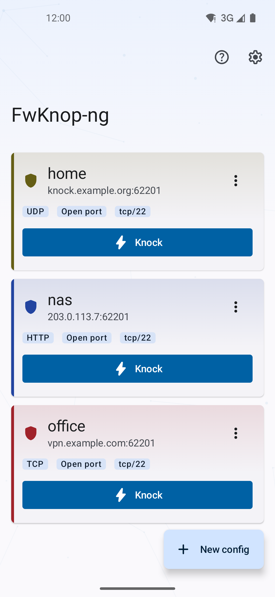
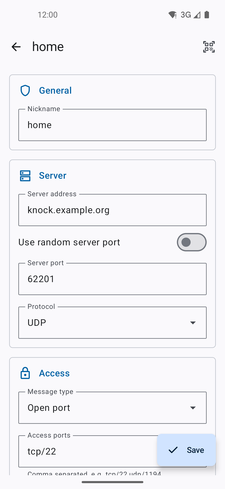
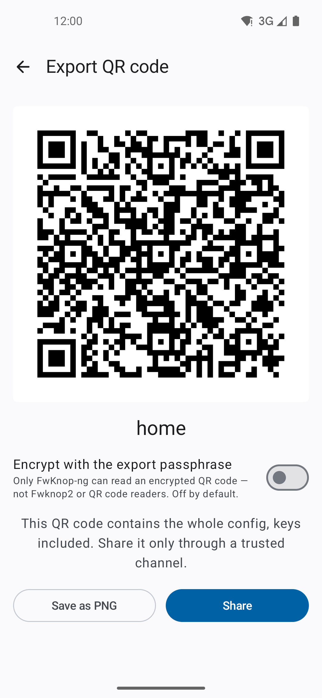
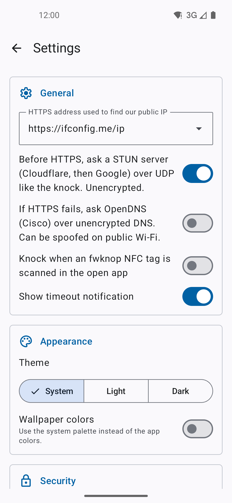
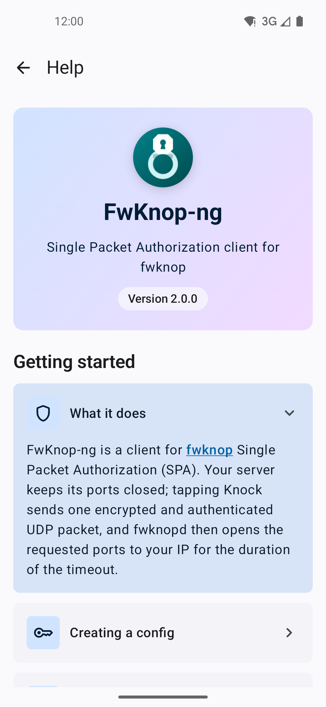

# FwKnop-ng


An Android client for [fwknop](https://www.cipherdyne.org/fwknop/) (Single Packet Authorization).

FwKnop-ng sends an encrypted, authenticated SPA packet that makes a `fwknopd` server open a firewall port for your IP address — keeping services such as SSH or VPN invisible to everyone else.

[](COPYING)


## Features

- **SPA encryption**: Rijndael (AES) or GPG (via [OpenKeychain](https://www.openkeychain.org/)), with HMAC authentication (MD5, SHA-1, SHA-256, SHA-384, SHA-512)
- **Transports**: UDP, TCP and HTTP
- **Access modes**: access, NAT access, local NAT and client-defined timeouts
- **Source IP resolution**: STUN or a configurable HTTPS lookup URL
- **Keep-open**: re-sends SPA packets before the firewall rule expires
- **Post-knock actions**: launch an SSH client, an OpenVPN profile or a WireGuard tunnel
- **Encrypted storage**: configurations protected by Android Keystore, Tink and SQLCipher
- **App lock**: biometrics or device credential
- **Backup & sharing**: encrypted backup/restore, QR code import/export
- **NFC**: trigger a knock by tapping an NFC tag
- **Languages**: English, French

## Screenshots

| Configurations | Edit | QR export | Settings | Help |
|:-:|:-:|:-:|:-:|:-:|
|  |  |  |  |  |

## Installation

- **F-Droid**: build metadata is available in [`metadata/`](metadata/fr.gildasledrogoff.fwknop.yml)
- **GitHub**: download the APK from the [releases page](https://github.com/gildas-le-drogoff/FwKnop-ng/releases)
- **From source**: see below

Requires Android 8.0 (API 26) or later.

> [!WARNING]
> Configurations are bound to the device's Android Keystore. Removing the screen lock or performing a factory reset makes them unrecoverable. Keep your fwknop keys elsewhere, or use the encrypted backup.

## Building

Requirements: JDK 21 and the Android SDK (compile SDK 37).

```sh
git clone https://github.com/gildas-le-drogoff/FwKnop-ng.git
cd FwKnop-ng
./gradlew assembleDebug
```

The APK is generated in `app/build/outputs/apk/`.

### Release signing

Release builds are signed only if a `keystore.properties` file exists at the project root; otherwise an unsigned release APK is produced.

```properties
storeFile=path/to/keystore.jks
storePassword=...
keyAlias=...
keyPassword=...
```

```sh
./gradlew assembleRelease
```

### Tests

```sh
./gradlew test                 # unit tests
./gradlew connectedAndroidTest # instrumented tests
```

Dependencies are locked; after changing a dependency, refresh the lockfiles with:

```sh
./gradlew dependencies --write-locks
```

## Architecture

Single-module app following a clean-architecture layout:

```
app/src/main/java/fr/gildasledrogoff/fwknop/
├── domain/        # models, repository interfaces, use cases, errors
├── data/          # SPA encoding, transports, Room/SQLCipher, Keystore vault, backup
├── presentation/  # Jetpack Compose UI, navigation, keep-open service
├── di/            # Hilt modules
└── utils/
```

Main libraries: Jetpack Compose (Material 3), Hilt, Room + SQLCipher, Tink, OkHttp, kotlinx.serialization, dnsjava, ZXing.

## Privacy

The app has no analytics or tracking. Besides the SPA packet sent to your `fwknopd` server, the only network requests are optional public IP lookups:

- STUN (`stun.cloudflare.com`, `stun.l.google.com`)
- HTTPS lookup URL (default `https://ifconfig.me/ip`, user configurable)

## Contributing

Bug reports and pull requests are welcome on the [issue tracker](https://github.com/gildas-le-drogoff/FwKnop-ng/issues).

## License

FwKnop-ng is licensed under the [GNU General Public License v2.0 or later](COPYING).

The vendored OpenPGP API (`org.openintents.openpgp`) is vendored from [open-keychain/openpgp-api](https://github.com/open-keychain/openpgp-api) under the Apache License 2.0; see [its README](app/src/main/java/org/openintents/openpgp/README.md).
